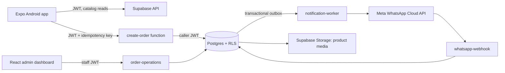
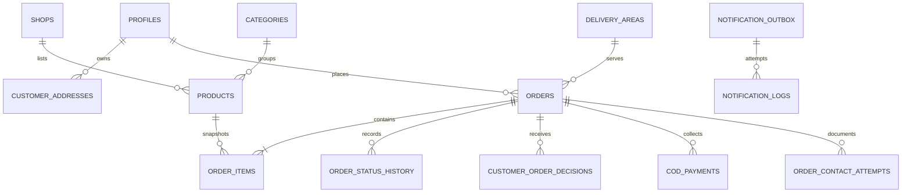

# Amar Bazar Backend Setup

This guide covers local review of the existing Supabase backend. It does not prove a live project is configured or deploy any code. Use a local or isolated staging Supabase environment; never point local reset commands at production.

## What is included

- PostgreSQL schema, constraints, indexes, RLS policies, transactional order functions, admin functions, and a local seed.
- Edge Functions for order submission, customer quote decisions, staff order operations, WhatsApp notification delivery, and webhook receipt.
- Expo Supabase client and phone OTP helpers. Client configuration accepts only a project URL and publishable key.
- The Phase 4 customer app now reads and submits through the Supabase client and Edge Functions when configured; the UI remains unchanged in branding.

## Architecture at a glance



Database domains:



The detailed column definitions are in [DATABASE_SCHEMA.md](DATABASE_SCHEMA.md). The private app schema contains staff-role helpers and internal notification functions; it is not exposed as an API schema. Internal tables also have no customer-facing table grants.

## Order API examples

### Submit an order request

POST /functions/v1/create-order requires a signed-in customer JWT and an Idempotency-Key UUID. The client sends product IDs and quantities only. It never sends prices, delivery fees, or totals.

```http
Authorization: Bearer <customer-access-token>
apikey: <publishable-key>
Idempotency-Key: 82b183ac-1608-4cb2-8f63-e8e1f30c9b91
Content-Type: application/json

{
  "areaId": "1c4bf562-9364-4bfa-b51c-f4f43fe2d6a9",
  "addressId": "f4c46e5f-f0f8-4f49-8658-1a32d9d6a2d1",
  "items": [
    { "productId": "e96ca2e6-06d9-4cb4-9a20-5d6f712cf201", "quantity": 2 }
  ],
  "customerNote": "Please call on arrival."
}
```

Expected first response is 201; replaying the same key and same canonical request returns 200. The database returns a quote estimate in pending_verification; this does not confirm the order or authorize dispatch. A changed request with the same key is rejected.

### Customer decision after shop verification

After staff confirms availability and stores a quote, the customer receives a quote version and can approve it:

```http
POST /functions/v1/customer-order-decision
Authorization: Bearer <customer-access-token>
apikey: <publishable-key>
Content-Type: application/json

{
  "orderId": "9a50be92-76f6-4ef9-a18c-b51a51c00b6d",
  "quoteVersion": 1,
  "decision": "approved"
}
```

Use changes_requested or rejected for the other supported choices. A decision is bound to the current quote version; stale decisions fail. Approval reserves tracked inventory atomically and opens the COD workflow. It does not mark the order delivered or paid. See [ORDER_WORKFLOW.md](ORDER_WORKFLOW.md) for all status transitions.

### Staff operations

POST /functions/v1/order-operations accepts an action and payload with a staff JWT. The SQL function checks the caller's role again; the Edge Function is not the authorization boundary. Actions include quote saving, phone outcomes, delivery-person assignment (`assign_delivery`), status transitions, COD collection, inventory adjustment, and role assignment. Only an existing admin can assign a staff role. Assign a delivery person before dispatch; the database rejects `out_for_delivery` without an active assignment.

## Local setup

Prerequisites: Node.js compatible with the existing Expo SDK, pnpm, Docker Desktop, and the Supabase CLI. Deno is needed only if running Edge Functions outside the CLI. These prerequisites are not currently all installed in this workspace, so the local Supabase commands below are instructions, not evidence of a completed local database run.

From the repository root:

```powershell
supabase start
supabase status
supabase db reset
Copy-Item supabase/functions/.env.example supabase/functions/.env.local
# Replace placeholders in .env.local with local-only values before starting functions.
supabase functions serve --env-file supabase/functions/.env.local
```

supabase db reset recreates only the local database and applies migrations plus seed.sql. Seed data intentionally sets orders_enabled = false, creates delivery areas with illustrative pilot fees, and creates no products or customer/staff records. These prices/fees are not approved business values. Enable ordering and load reviewed catalog and fee values only in a local environment for functional testing.

For SQL policy checks, inspect the local database with the Supabase Studio URL printed by supabase status. Do not run migration commands against a linked project. No project is linked by this implementation.

### Local admin bootstrap

The seed does not create an administrator. The protected role-assignment function requires an existing admin, so bootstrap the first local test admin directly from the local SQL editor after creating a local test user through phone OTP:

```sql
insert into app_private.admin_profiles(user_id, display_name, is_active)
values ('<local-auth-user-uuid>'::uuid, 'Local development admin', true);

insert into app_private.user_roles(user_id, role)
values ('<local-auth-user-uuid>'::uuid, 'admin');
```

Only use this in a disposable local database. Never grant admin to a customer account in production. Initial production admin provisioning needs a separately reviewed secure bootstrap procedure. In the current role model, admin represents the owner/admin authority; other roles are order_operator and catalog_manager.

## Expo client setup and preview

Copy the safe example and set only a local URL and publishable key:

```powershell
Copy-Item apps/customer/.env.example apps/customer/.env
# Edit apps/customer/.env with the local values shown by supabase status.
Set-Location apps/customer
pnpm install
pnpm start
```

Run on Android Emulator:

```powershell
pnpm android
```

For a physical Android device, connect the phone and computer to the same network and run pnpm start -- --lan; scan the Expo QR code in Expo Go if the project's current native dependencies are supported there. If testing against a local Supabase instance, use the computer's LAN IP as the Supabase host on a physical device. Android Emulator uses 10.0.2.2 to reach host services; the emulator API URL is typically http://10.0.2.2:54321. Confirm connectivity and SMS OTP settings locally first. The current app UI uses mock data and does not yet call real catalog/order APIs.

## Environment and WhatsApp

- apps/customer/.env.example contains only public Supabase URL and publishable key names.
- supabase/functions/.env.example contains the publishable key needed for caller-JWT verification plus server-only placeholders for service role, worker secret, Meta access token, phone number ID, API version, webhook verification token, and app secret. Only the publishable/anon key may be shared with a client; service-role and Meta secrets stay in the function environment.
- Do not put service-role or Meta secrets in EXPO_PUBLIC_*, the Android bundle, Git, or a public issue.
- Configure actual WhatsApp templates, consent, Meta app subscriptions, webhook URL, and secrets separately before delivery.
- The notification worker claims outbox jobs and records delivery attempts. It never approves, rejects, or changes an order. Ambiguous send outcomes are recorded as unknown to avoid duplicate customer messages.
- A failed WhatsApp send leaves the order and its state intact.

## Access-control summary

| Actor | Allowed access |
|---|---|
| Anonymous | Active catalog and delivery-area information only |
| Customer | Own profile, addresses, notification preferences, and own orders/decisions |
| Catalog manager | Catalog, shop, category, delivery-area and store-setting admin RPCs as granted |
| Order operator/support | Operational order reads and order-management RPCs |
| Owner | Staff-role assignment and owner/admin operations |
| Service worker | Private outbox processing and webhook event recording |

RLS protects table reads/writes, while order mutations go through narrowly granted database functions. Order creation reads current product prices, availability, inventory, and delivery fee in one database transaction. Customer-submitted totals are never trusted. Sensitive contact/address data is not publicly readable. Review [SECURITY_DESIGN.md](SECURITY_DESIGN.md) and [API_DESIGN.md](API_DESIGN.md) before connecting another client.

## Phase 3 review checklist and evidence

- [x] Migrations and local seed added; no live database was linked or modified.
- [x] Customer client has OTP request/verification helpers and secure public-key-only configuration.
- [x] Edge Functions preserve user JWT for customer/staff RPCs; server-only functions use server credentials.
- [x] Order pricing, idempotency, quote decision and stock reservation are designed to run transactionally in PostgreSQL.
- [x] API examples, local commands, architecture diagrams, role summary and emulator/device guidance included here.
- [ ] Apply migrations and run database/RLS tests on a local Supabase stack; Supabase CLI and Docker are unavailable in the current environment.
- [ ] Serve and type-check Edge Functions; Deno/Supabase CLI are unavailable in the current environment.
- [ ] Configure local auth/SMS provider, catalog, approved delivery fees, WhatsApp secrets/templates and webhook.
- [x] Phase 4 connects catalog, search, category filtering, cart, checkout, customer addresses, order history and quote approval to the approved Supabase interfaces.
- [ ] Run the end-to-end customer journey on a configured local Supabase stack with verified seed catalog, area, OTP and COD settings.
- [x] Separate React/Vite admin dashboard and role-scoped Supabase operations are present in the repository.
- [ ] Apply migrations and execute backend acceptance tests on a disposable local or isolated staging database before relying on any integration.
- [ ] Review and approve this backend phase before continuing.

No migration was applied to a live project in this work. The customer app and dashboard contain backend call paths, but server connectivity, SQL execution, RLS, Auth and the full customer journey remain unverified until a local/staging Supabase instance is available.

## Files added or updated

- supabase/migrations/ — schema, policies, transactional order workflows, admin RPCs and storage policies.
- supabase/functions/ — order, staff operations, notification worker and webhook.
- supabase/config.toml, supabase/seed.sql — local project settings and non-production seed.
- apps/customer/lib/supabase.ts, apps/customer/lib/auth.ts — Supabase client and phone OTP helpers.
- apps/customer/package.json, apps/customer/pnpm-lock.yaml — Supabase client dependencies.
- apps/customer/.env.example, supabase/functions/.env.example — safe environment templates.
- .gitignore — ignores local secrets and development caches.
- BACKEND_SETUP.md — this review guide.

## Official references

- [Supabase React Native Auth quickstart](https://supabase.com/docs/guides/auth/quickstarts/react-native)
- [Supabase Edge Function auth headers](https://supabase.com/docs/guides/functions/auth-headers)
- [Supabase CLI local configuration](https://supabase.com/docs/guides/local-development/cli/config)

