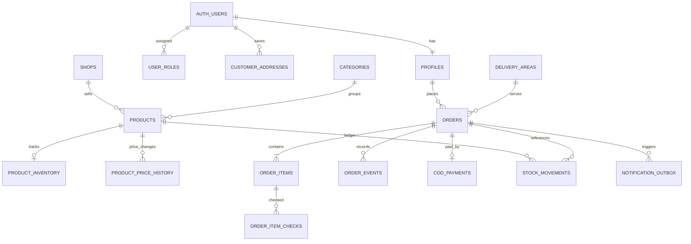

# Amar Bazar Database Schema

**Status:** logical schema proposal; no database or migrations created.  
The design assumes authenticated phone-based customer accounts, COD, optional tracked inventory, and shop-confirmed prices/availability.

## Conventions

- PostgreSQL UUID primary keys (`gen_random_uuid()`), UTC `timestamptz`, monetary values as `numeric(12,2)`, currency `BDT`.
- Use `public` only for API-facing tables that need Data API access; enable RLS on every such table. Keep role helpers, notification internals, and other non-client data in a non-exposed `app_private` schema.
- Prefer soft deactivation (`is_active=false`) over deleting referenced products, shops, categories, or areas. Use restrictive FKs where snapshots/audit history must remain valid.
- Never accept product prices, area fees, totals, status, or user ID as trusted client values.

## Relationship overview

## Tables

### Identity and roles

| Table | Columns and constraints |
| --- | --- |
| `profiles` | `id uuid PK REFERENCES auth.users(id) ON DELETE CASCADE`; `display_name text NOT NULL`; `phone_e164 text NOT NULL`; `created_at`, `updated_at timestamptz`; unique normalized phone. Keep auth phone authoritative and synchronize only through trusted flow. |
| `user_roles` (`app_private`) | `user_id uuid REFERENCES auth.users`; `role text CHECK IN ('admin','order_operator','catalog_manager')`; `assigned_by uuid REFERENCES auth.users`; `created_at`; PK `(user_id, role)`. Writes only by owner/admin role-management function; never from self-editable Auth metadata. |

Customers need one profile per Auth user. Staff can also have a profile. RLS role checks call a fixed-search-path helper in `app_private`; callers cannot write the role table.

### Catalog and delivery configuration

| Table | Columns and constraints |
| --- | --- |
| `shops` | `id uuid PK`; `name text NOT NULL`; `slug text UNIQUE NOT NULL`; `description text`; `image_path text`; `phone_e164 text`; `is_active boolean NOT NULL DEFAULT false`; `created_at`, `updated_at`. |
| `categories` | `id uuid PK`; `parent_id uuid NULL REFERENCES categories`; `name text NOT NULL`; `slug text UNIQUE NOT NULL`; `sort_order int NOT NULL DEFAULT 0`; `is_active boolean NOT NULL DEFAULT true`. |
| `products` | `id uuid PK`; `shop_id uuid NOT NULL REFERENCES shops`; `category_id uuid NOT NULL REFERENCES categories`; `sku text NULL`; `name text NOT NULL`; `description text`; `image_path text`; `unit_label text NOT NULL`; `price numeric(12,2) NOT NULL CHECK (price >= 0)`; `currency char(3) NOT NULL DEFAULT 'BDT' CHECK (currency='BDT')`; `is_active boolean NOT NULL DEFAULT false`; `is_available boolean NOT NULL DEFAULT false`; `track_stock boolean NOT NULL DEFAULT false`; `created_at`, `updated_at`; unique `(shop_id, sku)` when SKU is not null. One row represents a sellable size/variant; variants can be modeled explicitly later if needed. |
| `product_price_history` | `id bigint GENERATED ALWAYS AS IDENTITY PK`; `product_id uuid REFERENCES products ON DELETE RESTRICT`; `old_price`, `new_price numeric(12,2) CHECK >= 0`; `changed_by uuid REFERENCES auth.users`; `changed_at timestamptz`; `reason text`. Inserted by trusted catalog function/trigger, not client. |
| `product_inventory` | `product_id uuid PK REFERENCES products ON DELETE RESTRICT`; `on_hand int NOT NULL CHECK >=0`; `reserved int NOT NULL DEFAULT 0 CHECK >=0 AND reserved <= on_hand`; `updated_at timestamptz`. Only used when product `track_stock=true`; partner items can remain untracked. |
| `delivery_areas` | `id uuid PK`; `name text NOT NULL`; `slug text UNIQUE NOT NULL`; `fee numeric(12,2) NOT NULL CHECK >=0`; `currency char(3) NOT NULL DEFAULT 'BDT' CHECK`; `is_active boolean NOT NULL DEFAULT false`; `effective_from timestamptz`; `effective_until timestamptz NULL`; `CHECK (effective_until IS NULL OR effective_from IS NULL OR effective_until > effective_from)`; `sort_order int`; `updated_by uuid REFERENCES auth.users`; `updated_at timestamptz`. |

### Customer address and orders

| Table | Columns and constraints |
| --- | --- |
| `customer_addresses` | `id uuid PK`; `customer_id uuid NOT NULL REFERENCES auth.users ON DELETE CASCADE`; `label text`; `recipient_name text NOT NULL`; `phone_e164 text NOT NULL`; `area_id uuid NOT NULL REFERENCES delivery_areas ON DELETE RESTRICT`; `address_line text NOT NULL`; `landmark text`; `latitude numeric(9,6)`, `longitude numeric(9,6)`; check coordinates are both null or both present and within geographic ranges; `is_default boolean`; `created_at`, `updated_at`. Owner-only RLS. |
| `customer_notification_preferences` | `customer_id uuid PK REFERENCES auth.users ON DELETE CASCADE`; `whatsapp_order_updates boolean NOT NULL DEFAULT false`; `consent_source text`; `consent_at timestamptz NULL`; `revoked_at timestamptz NULL`; `updated_at timestamptz`. Check enabled consent requires `consent_at IS NOT NULL AND revoked_at IS NULL`; consent changes are timestamped by a server function before sends. |
| `orders` | `id uuid PK`; `public_code text UNIQUE NOT NULL` (non-sequential random reference); `customer_id uuid NOT NULL REFERENCES auth.users ON DELETE RESTRICT`; `idempotency_key uuid NOT NULL`; unique `(customer_id,idempotency_key)`; `status order_status NOT NULL`; `customer_decision customer_decision NOT NULL DEFAULT 'pending'`; `area_id uuid NOT NULL REFERENCES delivery_areas ON DELETE RESTRICT`; immutable `area_name_snapshot text NOT NULL`; `recipient_name_snapshot`, `phone_snapshot`, `address_snapshot text NOT NULL`; `landmark_snapshot text`; `latitude`, `longitude numeric`; `customer_note text`; `estimated_subtotal`, `estimated_delivery_fee`, `estimated_total numeric(12,2) NOT NULL CHECK >=0`; `final_subtotal`, `final_delivery_fee`, `final_total numeric(12,2) NULL CHECK >=0`; `quote_version int NOT NULL DEFAULT 0 CHECK >=0`; `estimated_eta text NULL`; `created_at`, `updated_at`; `confirmed_at`, `completed_at`, `cancelled_at timestamptz NULL`. Snapshot fields preserve what the customer requested even if address/catalog later changes. |
| `order_items` | `id uuid PK`; `order_id uuid NOT NULL REFERENCES orders ON DELETE RESTRICT`; `product_id uuid NULL REFERENCES products ON DELETE SET NULL`; `shop_id uuid NULL REFERENCES shops ON DELETE SET NULL`; requested snapshots `requested_name`, `requested_unit_label text NOT NULL`, `requested_unit_price numeric(12,2) NOT NULL CHECK >=0`, `quantity int NOT NULL CHECK BETWEEN 1 AND 99`; verified fields `fulfillment_state item_fulfillment NOT NULL DEFAULT 'pending'`, `fulfilled_product_id uuid NULL REFERENCES products ON DELETE SET NULL`, `fulfilled_name text NULL`, `final_unit_price numeric(12,2) NULL CHECK >=0`; `created_at`; unique `(order_id, product_id)` when product_id is not null. Requested fields are immutable after create. |
| `order_item_checks` | `id uuid PK`; `order_item_id uuid NOT NULL REFERENCES order_items ON DELETE RESTRICT`; `checked_by uuid NOT NULL REFERENCES auth.users`; `result item_fulfillment NOT NULL`; `verified_unit_price numeric(12,2) NULL CHECK >=0`; `alternative_product_id uuid NULL REFERENCES products`; `alternative_name text`; `note text`; `checked_at timestamptz NOT NULL`; preserve each re-check as a new record. |
| `order_contact_attempts` | `id uuid PK`; `order_id uuid NOT NULL REFERENCES orders ON DELETE RESTRICT`; `quote_version int NOT NULL`; `attempted_by uuid NOT NULL REFERENCES auth.users`; `channel text NOT NULL CHECK IN ('phone')`; `outcome text NOT NULL CHECK IN ('no_answer','callback_requested','approved','changes_requested','rejected')`; `note text`; `attempted_at timestamptz NOT NULL`. Each call attempt is append-only; only an explicit customer decision outcome can be applied by the guarded phone-outcome function. |
| `order_events` | `id bigint GENERATED ALWAYS AS IDENTITY PK`; `order_id uuid NOT NULL REFERENCES orders ON DELETE RESTRICT`; `from_status order_status NULL`; `to_status order_status NOT NULL`; `actor_user_id uuid NULL REFERENCES auth.users`; `source text NOT NULL CHECK IN ('customer_app','admin','system','phone_call')`; `reason text`; `created_at timestamptz`; append-only. No secrets or unnecessary phone/address data in metadata. |
| `customer_order_decisions` | `id uuid PK`; `order_id uuid NOT NULL REFERENCES orders ON DELETE RESTRICT`; `customer_id uuid NOT NULL REFERENCES auth.users`; `quote_version int NOT NULL`; `decision customer_decision NOT NULL CHECK IN ('approved','changes_requested','rejected')`; `source text NOT NULL CHECK IN ('app','phone_call')`; `recorded_by uuid NULL REFERENCES auth.users`; `note text`; `created_at`; unique `(order_id, quote_version)` for the final decision on a quote. Phone decision requires staff actor and an audited call note/outcome. |

### COD, inventory, notifications

| Table | Columns and constraints |
| --- | --- |
| `cod_payments` | `id uuid PK`; `order_id uuid UNIQUE NOT NULL REFERENCES orders ON DELETE RESTRICT`; `status text NOT NULL CHECK IN ('pending','collected','exception','refunded')`; `amount_due numeric(12,2) NOT NULL CHECK >=0`; `amount_collected numeric(12,2) NOT NULL DEFAULT 0 CHECK >=0`; `collected_by uuid NULL REFERENCES auth.users`; `collected_at timestamptz NULL`; `note text`; `updated_at`; state/amount consistency checks. Insert pending row when order is confirmed; only authorized staff function can record collection. |
| `stock_movements` | `id bigint GENERATED ALWAYS AS IDENTITY PK`; `product_id uuid NOT NULL REFERENCES products ON DELETE RESTRICT`; `order_id uuid NULL REFERENCES orders ON DELETE RESTRICT`; `actor_user_id uuid NULL REFERENCES auth.users`; `movement_type text CHECK IN ('adjustment','reserve','release','sale','return')`; `quantity_delta int NOT NULL`; `created_at`; `reason text`. Append-only ledger; stock change and ledger insert in same transaction. |
| `notification_outbox` (`app_private`) | `id uuid PK`; `order_event_id bigint NOT NULL REFERENCES order_events ON DELETE RESTRICT`; `order_id uuid NOT NULL REFERENCES orders ON DELETE RESTRICT`; `event_type text NOT NULL`; `channel text NOT NULL CHECK IN ('whatsapp')`; `template_name text NOT NULL`; `status text NOT NULL CHECK IN ('pending','processing','sent','retry','dead_letter','unknown')`; `attempt_count int NOT NULL DEFAULT 0 CHECK >=0`; `next_attempt_at timestamptz`; `locked_by text NULL`; `lease_until timestamptz NULL`; `provider_message_id text NULL`; `last_error_code text NULL`; `created_at`, `updated_at`; unique `(order_event_id,channel)`. `order_event_id` is the notification deduplication key; keep recipient lookup in protected order data and avoid duplicating PII in payload. |
| `notification_webhook_events` (`app_private`) | `id bigint GENERATED ALWAYS AS IDENTITY PK`; `provider_event_key text UNIQUE NOT NULL`; `provider_message_id text`; `event_type text NOT NULL`; `received_at timestamptz`; `processed_at timestamptz`; minimal redacted payload needed for dedup/debug. |

## Enums

- `order_status`: `pending_verification`, `awaiting_customer_approval`, `confirmed`, `preparing`, `out_for_delivery`, `delivered`, `cancelled`, `rejected`, `expired`.
- `customer_decision`: `pending`, `approved`, `changes_requested`, `rejected`.
- `item_fulfillment`: `pending`, `available`, `unavailable`, `substituted`.

Transitions are not free-form enum updates: database transition functions enforce allowed paths and append an `order_events` row.

## Indexes

- `products (is_active, category_id, shop_id)` partial for active products; `products (shop_id, name)`; optional trigram/text-search index for catalog search.
- `delivery_areas (is_active, sort_order)`.
- `customer_addresses (customer_id, is_default)`.
- `orders (customer_id, created_at DESC)`; `orders (status, created_at)` for admin queues; unique `(customer_id,idempotency_key)`; unique `public_code`.
- `order_items (order_id)` and `order_item_checks (order_item_id, checked_at DESC)`.
- `order_events (order_id, created_at)`.
- `stock_movements (product_id, created_at DESC)` and `(order_id)`.
- `notification_outbox (status, next_attempt_at)` partial for jobs ready to process.
- Each RLS policy's filter/join columns must have a supporting index where query volume warrants it, especially `customer_id`, `order_id`, and role `user_id`.

## RLS policy matrix

RLS is enabled and direct grants are minimized for every exposed table. These are policy intentions, not applied SQL.

| Data | Anonymous | Authenticated customer | Staff |
| --- | --- | --- | --- |
| Active shops/categories/products/approved images/active areas | Read only | Read only | Read; mutations via authorized staff function |
| Profiles | None | Read/update own allowed fields only | Limited operational access; no unrestricted export |
| Saved addresses | None | Select/insert/update/delete own rows | Access only through an order workflow; no broad browsing |
| Orders | None | Select own orders; no direct insert/update/delete | Select work queue/details as role allows; mutations via transition functions |
| Order items | None | Read customer-safe projection for own orders only | Read relevant orders; mutate through guarded functions |
| Item checks, contact attempts and staff notes | None | No direct access | Authorized operators only; append through guarded functions |
| Order events and customer decisions | None | Read sanitized customer status/decision feed for own orders | Read relevant orders; append via guarded functions |
| Phone contact attempts | None | No access to internal call notes | Order operators only; append through call logging function |
| COD and stock ledgers | None | No access | Authorized operational functions; no direct client mutation |
| Roles/outbox/webhook event internals | None | None | Role management through owner function; outbox/webhooks only backend |

`customer_notification_preferences` writes go through a consent function that sets `consent_at`/`revoked_at` server-side; do not permit the customer to forge historical consent timestamps by directly updating the row.

Expose customer order details through narrowly scoped `security_invoker` views (for example `customer_order_items` and `customer_order_feed`) that apply the caller's RLS and omit operator notes, phone-attempt notes, internal IDs and staff-only metadata. Do not grant customers direct `SELECT` on check/contact-attempt tables.

Customer reads use `(select auth.uid()) = customer_id` or an `EXISTS` ownership check through `orders`. Staff role helper is in a non-exposed schema, fixed `search_path`, and inaccessible for writes from clients. RLS does not replace SQL grants; grant only required select/function privileges. Protect storage uploads with authenticated staff policies and enforce MIME/size/path constraints.

## Transactional functions

Implement as PostgreSQL functions/RPC with fixed `search_path`, explicit `auth.uid()`/role validation, typed inputs, constraints, and transaction-level atomicity:

1. `create_order(idempotency_key, area_id, address fields, item_ids_and_quantities)`:
   - Require authenticated customer; validate address, active service area, active/available products, quantity limits, cart item count, and tracked stock availability.
   - Load price, name, unit, shop, and fee from DB; ignore client money values.
   - Insert order + item snapshots + pending event; compute estimates; enqueue request-received outbox message if opted in, keyed to that event.
   - On an existing `(customer_id,idempotency_key)`, compare canonical item IDs/quantities and normalized delivery/contact inputs against the saved request snapshot: identical retry returns that order; different payload returns an idempotency conflict. Do not store an unhashed copy of the request solely for idempotency.
2. `save_order_quote(order_id, quote_version_expected, line results, final_fee, eta)`:
   - Require authorized order operator; lock order row; verify current status and version; validate substitutions and final prices; store check history; compute final totals; increment quote version; reset current decision to `pending`; set `awaiting_customer_approval`; append event and outbox entry atomically.
3. `decide_order_quote(order_id, quote_version, decision)`:
   - Require order owner; lock row; ensure status awaiting approval and quote version matches; insert unique decision. Approval reserves tracked stock atomically and confirms order; changes requested return to verification; reject cancels/releases any reservation. Emit event and notification job.
4. `record_phone_outcome(order_id, quote_version, outcome, note)`:
   - Require order operator; append any attempt outcome (`no_answer`, `callback_requested`, or explicit customer decision). Only explicit approval/change/rejection after communicating the current quote may update decision/status; actor/source/time are captured and state checks match in-app approval.
5. `transition_order(order_id, next_status)`:
   - Require permitted staff role and allowed transition; delivery completion consumes reserved stock and opens COD collection record; cancellation releases reservations when eligible; append event.
6. `record_cod_collection(order_id, amount, note)`:
   - Require authorized operational role; only at an eligible delivery stage; idempotently record collected amount and actor/time; reject amount beyond configured tolerance and preserve exceptions.
7. `record_notification_consent(enabled, source)`:
   - Require authenticated customer; timestamp opt-in/revocation on the server and update only that customer's preference. Worker rechecks current consent immediately before sending.

Stock reservation uses `SELECT ... FOR UPDATE`/conditional updates and ledger writes in the same transaction. Order creation does not decrement stock. Approval only reserves tracked products; `delivered` consumes them; eligible cancellation releases them. Untracked items remain manual confirmation only.

