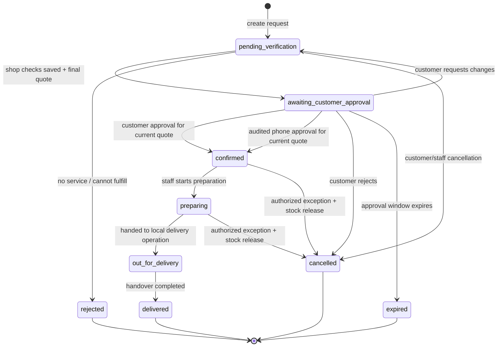

# Amar Bazar Order Workflow

**Status:** proposed operational and technical flow; no implementation performed.  
Order state is authoritative in PostgreSQL. UI, Realtime and WhatsApp only display or signal the server state.

## 1. Customer journey

1. Customer signs in by phone OTP (or resumes existing authenticated session).
2. Customer browses active products, adds quantities to a local cart, selects delivery area and enters/chooses an address.
3. Checkout submits product IDs and quantities, area/address, customer note and an idempotency key. It submits no trusted prices or totals.
4. Server validates user, area, products, availability, quantities and optional tracked stock; reads current prices/fee; creates order, item snapshots, initial estimate, event and notification job atomically.
5. App displays **Request received — awaiting shop and customer confirmation** with a non-final estimate. This is not an accepted order and no preparation should begin.
6. Order operator opens the queue and contacts each participating shop to verify availability and current price. Operator records item-by-item outcome, alternative (if any), delivery fee and estimated delivery time.
7. System calculates the final quote, increments quote version, stores verification history, changes state to `awaiting_customer_approval`, and sends a notification if the customer has opted in.
8. Customer reviews the updated items, unavailable/substitute lines, delivery fee, ETA and final total. Customer approves, requests changes, or rejects/cancels. Alternatively, an operator can record explicit verbal approval after a phone call, with actor, time, quote version and call note audited.
9. On approval, a database transaction validates the exact quote version and state, reserves tracked inventory where applicable, sets the order to `confirmed`, creates pending COD record and records the event. If stock reservation conflicts, do not confirm; return to verification and issue a corrected quote.
10. Staff marks `preparing`, then `out_for_delivery`, then `delivered`. At handover, authorized staff records COD collection separately. Order completion and payment collection are independently auditable.

## 2. State machine

No arbitrary status editing. All transitions go through a transaction function with role, owner/decision, current state, quote-version and inventory checks. Every transition appends an immutable event. `delivered` cannot imply COD collected; a COD record can remain an exception for reconciliation.

## 3. Quote and approval semantics

- Initial estimate uses current catalog price and area fee from the server. Mark it as non-final in UI.
- Staff's shop check sets `available`, `unavailable`, or `substituted` per line. An alternate product requires its identity/name and verified price; customer sees it before approval.
- `final_subtotal` is sum of verified available/substituted line price × quantity; unavailable lines contribute zero. `final_total = final_subtotal + final_delivery_fee`.
- `quote_version` increments for every changed final quote. Customer decision includes the current version. A stale click gets a conflict response and the new quote must be reviewed.
- When a revised quote is saved, current decision resets to `pending`; prior decisions and call attempts remain in append-only history.
- Approval confirms only that quote. Any subsequent item, fee or total change returns order to verification and requires a new customer decision.
- If customer requests a change, staff edits/rechecks and sends a new version. Rejection or timeout closes the request; no stock is consumed.
- Phone approval is a fallback for the planned local human workflow. Only an authenticated operator may record it; the record includes the order, version, explicit affirmative outcome, time and operator. A missed call/no answer is not approval.

## 4. Stock handling

- Default partner catalog mode is `untracked`; staff must ask the shop. Do not imply real-time inventory.
- For `track_stock=true`, order submission checks stock but does not reserve it while the shop/customer review is pending.
- When customer approves, atomic transaction reserves quantities. Concurrent reservations cannot exceed `on_hand`.
- At delivery, decrement `on_hand` and clear the reservation in one transaction, recording stock movement.
- On eligible cancellation before fulfillment, release reservation. If stock already consumed, record a return/adjustment according to operational policy rather than silently restoring.
- Admin adjustments always include reason and actor; ledger is append-only.

## 5. COD workflow

- COD record is created pending when order reaches confirmed.
- Customer sees amount due in approved final quote; fee and items are included in `final_total`.
- At handover, staff records collected amount and actor. If correct, set collected; if mismatch/no collection, set exception with note and alert admin for reconciliation.
- Never mark a payment collected from customer UI or by a WhatsApp delivery callback.
- No online payment gateway, refund automation or partial-payment feature is included in release one. Any expansion requires a separate payment/security design.

## 6. Cancellation, timeout and recovery

- Customer may cancel before confirmation through an owner-scoped endpoint. After confirmation, the app explains that staff must handle cancellation; authorized staff records outcome.
- If no shop response, mark awaiting verification exception and contact customer; never auto-confirm based on stale data.
- A scheduled expiry function may move an unanswered quote from `awaiting_customer_approval` to `expired` only after the owner-approved response window; it records an event and releases any eligible reservation.
- If customer does not respond by a configured business window, expire the quote and release any held inventory (normally none until approval). The timeout value is a business decision to confirm.
- If notification fails, the order remains in its state. Staff sees notification failure and uses the agreed phone fallback.
- If order creation response is lost, retry with the same idempotency key and retrieve the already-created order.
- If database transaction fails, no partial order/stock/event/payment changes remain.
- If stock conflicts at approval, do not silently change the quote; return to shop verification and obtain fresh approval.

## 7. Operational queue and service targets

Define before launch: staffed order hours, target time to first shop check, number of call attempts, no-answer process, approval expiry, delivery ETA language, after-hours behavior, and who handles COD reconciliation. The website's previous “20 minutes” claim should not be made a system guarantee unless pilot data supports it.

