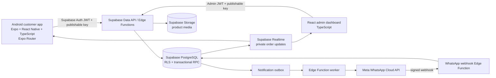

# Amar Bazar System Architecture

**Status:** proposed design for approval; no implementation performed.  
**Product scope:** Android-first grocery and local-shop customer app, separate React web admin dashboard, Supabase backend, COD in the first release, official Meta WhatsApp Cloud API for transactional notifications. No rider app in release one.

## 1. Architecture overview



The Android app and admin dashboard are separate clients of one backend. Public catalog reads may use Supabase's client API with the publishable key and restrictive read policies. Every write affecting prices, stock, orders, roles, payment, or order state goes through an authenticated Edge Function and a database transaction/RPC. The database is the source of truth; UI totals and client state are provisional only.

### Trust boundaries

1. **Untrusted client:** Android app and browser admin UI. Never trust supplied user ID, price, total, role, stock, status, or approval state.
2. **Authenticated API layer:** Supabase Auth JWT identifies the caller. Edge Functions validate identity, request shape, role, and rate limits; database policies/functions enforce authorization again.
3. **Database:** PostgreSQL constraints, RLS, and transaction functions enforce durable invariants and atomic order/stock transitions.
4. **External messaging:** Meta credentials live only in Edge Function secrets. Signed webhooks are verified before processing.

## 2. Android customer application

### App structure

- Expo, React Native, TypeScript, Expo Router, Android as the launch platform.
- Feature-first folders: `features/auth`, `catalog`, `cart`, `checkout`, `orders`, `profile`, `addresses`, `support`.
- Shared UI: Amar Bazar palette, typography, Bengali logo assets, buttons, cards, form fields, confirmation dialogs, loading/error/empty states.
- Data access isolated behind typed services/repositories; screens do not call raw SQL or trust returned client cache as final pricing.
- Local cart persisted on-device (e.g. AsyncStorage/SecureStore only for appropriate data); server recalculates every order. Do not persist sensitive address/phone data in plaintext longer than product requirements need.

### Expo Router screen map

- `(auth)/phone` and `(auth)/verify`: phone OTP sign-in/verification using Supabase Auth.
- `(tabs)/index`: home, category discovery, search, and featured shops/products.
- `category/[slug]`, `shop/[slug]`, `product/[id]`: catalog detail and shop menu.
- `cart`, `checkout`: quantity review, delivery area/address, fee estimate, request submission.
- `orders/index`, `orders/[id]`: customer-owned orders, approval quote, status timeline, support.
- `profile`, `addresses`, `help`: account, saved addresses, contact/support and privacy controls.

Require an authenticated customer for order creation so every order is bound to an Auth identity and can be protected by owner-only RLS. The preferred sign-in is phone OTP. The manual customer call after shop verification remains a distinct human confirmation step; OTP proves control of a phone number, not that the person approves a particular order.

### App state and offline behavior

- Cache safe catalog data and images for performance; show when cached and refresh when online.
- Keep cart state local until checkout. If persistent cross-device carts become needed, add a server cart later; it is not required for the initial release.
- Queue no order submission offline. Explain connection state and allow retry using the same idempotency key.
- Order details come from RLS-protected database queries. Realtime is an optimization; after reconnect or notification, refetch the authoritative order.

## 3. Admin dashboard

Separate React + TypeScript web app; use a maintained React build setup chosen during implementation. Admin routes require Supabase Auth and server-verified staff roles. Hide controls in the UI for usability, but treat database RLS and protected functions as the actual security boundary.

Initial modules:

- Order queue: pending shop checks, awaiting customer approval, confirmed/preparing/out for delivery, exceptions.
- Order detail: verify each line with the shop, mark unavailable, offer a substitute, set final price/fee/ETA, log call result, and send the customer approval request.
- Catalog: shops, categories, products, units/variants, current price, availability, optional stock tracking, menu image and last-verified date.
- Delivery areas: service status, displayed name, fee and effective date.
- Staff access: invite/revoke role assignments (owner/admin only), audit log.
- Operations: COD collection reconciliation and notification delivery status.

No customer-facing admin controls or shared “staff PIN” in the Android app. A separate rider app is explicitly outside release-one scope; staff can manually mark dispatch status in admin.

## 4. Supabase backend

- **Auth:** phone OTP for customers; staff accounts provisioned/invited and assigned roles by an authorized owner. Do not accept role claims from user-editable metadata.
- **PostgreSQL:** catalog, service areas, private customer data, notification preferences, order snapshots, stock ledger, COD record, audit events, and notification outbox.
- **RLS:** enabled on every exposed table. Grant only the operations needed per role; policies restrict customer rows to `auth.uid()` and staff actions to database-verified role membership.
- **Database functions/RPC:** create order, prepare verification quote, record customer decision, transition order, reserve/release stock, and record COD collection. Functions must validate caller, use fixed `search_path`, and make state changes atomically.
- **Edge Functions:** authenticated application boundary for workflows and input/rate-limit checks; WhatsApp send worker and webhook receiver for external integration. Keep secrets in Supabase Edge Function secrets/Vault, never app config or source.
- **Storage:** product/shop media. Public read bucket only for approved catalog images; upload/update/delete restricted to authorized catalog staff. No customer address documents are needed in v1.
- **Realtime:** private subscriptions to a customer's own order changes and authorized staff order queues. Realtime is not the durable notification mechanism; clients refetch after reconnect.

## 5. Core order and money model

- Price and fee values use PostgreSQL `numeric(12,2)` and currency code `BDT`; do not use floating point for money.
- On request creation, server loads current active products and delivery fee, validates quantity and any tracked stock, creates immutable item/name/unit/request-price snapshots, and computes an **estimate**.
- Staff checks availability with the shop and records each line's availability, verified price, or substitution. The final quote includes verified line prices, delivery fee, and ETA; quote version increments each time it changes.
- Customer approves that exact quote version in-app, or staff records a verbal approval with operator identity, time, and call outcome. Only then may the order become confirmed.
- Inventory is optional per product. For tracked products, a conditional reservation occurs atomically on approval. Untracked partner stock requires manual shop verification and is never represented as exact stock.
- COD payment begins as pending. Only authorized operations can record amount collected; delivery completion and COD collection remain separately auditable.

**Provisional cart assumption for v1:** allow items from multiple active partner shops in one order, with one delivery run and one delivery fee determined by the selected area. The operator verifies each shop's items before building the quote. Confirm this operating model with the owner before implementation; if the team cannot reliably collect from multiple shops per order, restrict each cart to one shop or split orders and rework fees/checkout.

## 6. WhatsApp and order notifications

Database state changes enqueue notification jobs in the same transaction. A worker sends approved WhatsApp templates to customers who opted in. Messages link to a secure app/deep-link order screen; approval must still be authenticated and tied to the active quote version. Meta delivery webhooks update notification delivery records, not order state. An undelivered WhatsApp message must never silently approve, cancel, or block an order; staff can use the documented phone fallback.

## 7. Error and recovery strategy

- Return stable error codes and a safe human-readable message; log internal details server-side with request/order IDs and redact phone/address values.
- Database transaction failures roll back the entire order/stock/quote mutation.
- Retry transient reads and notification sends with bounded exponential backoff; do not retry a non-idempotent create call with a new key.
- Unique idempotency constraint prevents duplicate orders when a mobile client times out and retries.
- Outbox jobs have attempts, last error category, next-attempt time, and dead-letter/manual-review state.
- Reconcile order transitions and COD totals using immutable event and stock/payment ledgers; provide admin recovery for stuck notifications and exceptions.
- Show order request as submitted only after server confirms a committed order. If response is ambiguous, retry with the same idempotency key and retrieve the existing result.

## 8. GitHub repository layout

Proposed monorepo, retaining the existing website as a separate marketing/pilot artifact until its future is decided:

```text
amar-bazar/
  apps/
    customer/                 # Expo + React Native + TypeScript + Expo Router
    admin/                    # React + TypeScript web dashboard
    marketing/                # existing static pilot site/assets, if retained
  packages/
    domain/                   # shared types, enums, validation and money rules
    ui-tokens/                # design tokens and shared assets where practical
  supabase/
    config.toml
    migrations/
    seed.sql                  # development/demo seed only; no unverified live prices
    functions/
      create-order/
      verify-order/
      customer-order-decision/
      transition-order/
      whatsapp-send-worker/
      whatsapp-webhook/
  docs/                       # these architecture documents
  .github/workflows/          # lint/typecheck/test/build checks; deploy workflows separately
  README.md
```

Keep migrations and Edge Functions version-controlled. Protect `main`, require review/checks before release, and do not commit `.env`, service-role keys, Meta tokens, customer exports, or signing keystores.

## 9. Android APK/AAB release strategy

- **Development:** Expo development build (`.apk`) for local device testing; use development-only Supabase project/data.
- **Internal pilot:** signed internal-distribution `.apk` for direct installation and a separate staging Supabase environment. Treat any installed APK as a real client and keep RLS enforced.
- **Store release:** production signed `.aab` with monotonically increasing Android version code, release channel/environment, privacy policy, app listing, and Google Play App Signing. Store upload key and recovery details in secure credential storage, not Git.
- **Build profiles:** `development`, `preview`, and `production`; distinct Supabase URLs/public keys through environment configuration. Only public/publishable Supabase key goes in client builds.
- **Release gates:** review data/area accuracy, auth and RLS tests, order/stock/payment workflow tests, Android device QA, backup/monitoring, Meta template approval and opt-in process, and rollback plan before distribution.
- Expo Build (the `eas build` CLI workflow) can generate APK/AAB artifacts and manage signing credentials. Google Play publication requires the applicable Play Console account and release setup; build artifacts alone do not publish the application.

## 10. Decisions requiring product-owner confirmation before implementation

1. Is phone OTP acceptable, or must customers be able to browse and submit a guest request?
2. Who may record verbal customer approval, and what call outcome evidence is required?
3. Which products will use tracked stock versus shop-confirmed availability only?
4. Confirm the v1 mixed-shop cart assumption: one delivery run and one area fee for the entire order, or restrict/split by shop.
5. Is COD the only initial payment method, and who reconciles collected cash?
6. Which areas/fees and catalog prices have been confirmed by partners, and who can change them?
7. What WhatsApp consent wording/channel and opt-out process will be used?

## Platform references

- [Expo Router](https://docs.expo.dev/router/introduction/)
- [Expo Android builds](https://docs.expo.dev/build-reference/android-builds/)
- [Expo Android APK configuration](https://docs.expo.dev/build-reference/apk/)
- [Supabase Auth](https://supabase.com/docs/guides/auth)
- [Supabase Row Level Security](https://supabase.com/docs/guides/database/postgres/row-level-security)
- [Supabase Edge Functions](https://supabase.com/docs/guides/functions)
- [Supabase Realtime](https://supabase.com/docs/guides/realtime)
- [WhatsApp Cloud API](https://developers.facebook.com/docs/whatsapp/cloud-api/)

