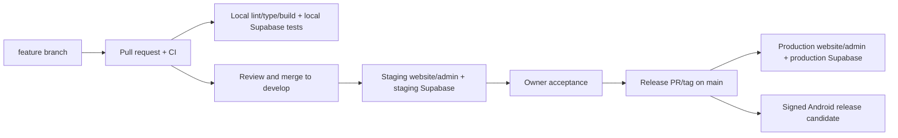

# Amar Bazar — Deployment Architecture

**Status:** Proposed deployment design; no hosting, DNS, GitHub, Supabase or EAS settings changed.

## Hosting map

| Component | Recommended host | URL shape | Deployment artifact |
|---|---|---|---|
| Public customer website | Cloudflare Pages (commercial static hosting) | `https://<owned-domain>` | Built root static site; preserve current HTML/CSS/vanilla JS and add only a build/bundle step if required for the Supabase client |
| Admin dashboard | Separate Cloudflare Pages project | `https://admin.<owned-domain>` | `apps/admin` Vite production bundle |
| Android customer app | Expo/EAS Build → Google Play internal/closed test → production | Amar Bazar app ID already appears as `com.amarbazar.customer`; verify ownership and release config before use | Signed APK/AAB from controlled EAS profile |
| Backend | Supabase hosted platform | Project-specific Supabase URL per environment | Ordered SQL migrations + Edge Function source; separate secrets/config per environment |
| Source/automation | GitHub repository + GitHub Actions | repository | Source, reviews, CI and release records; never production data/secrets |

### GitHub Pages warning

The existing workflow uploads the entire repository root with `path: .` on `main`. GitHub documents that Pages is not intended/permitted as free hosting for a website primarily directed at facilitating commercial transactions/e-commerce ([GitHub Pages limits and policy](https://docs.github.com/en/pages/getting-started-with-github-pages/github-pages-limits)). Therefore:

- Do not use GitHub Pages as Amar Bazar's live ordering or checkout host.
- It can remain a non-transactional preview/reference only if the page clearly cannot accept real customer details/orders.
- Use Cloudflare Pages or another commercial host for the live store and separate admin site.
- Explicitly build and deploy only each site's intended artifact directory; do not upload backend source, docs, `.env*`, local database data or arbitrary repository root.

## Environment deployment flow

Suggested Git flow for this small project:

- `main`: reviewed release source only; protect it, require a pull request and green CI before merge.
- `develop`: shared integration/staging branch; feature work uses short-lived `feature/<topic>` branches.
- Tag approved releases (for example `v0.1.0`) and record the exact commit, migration set, build IDs and verification report.
- Avoid long-running divergence; if the owner prefers a simpler single-developer flow, use feature branches → PR → `main` and deploy preview/staging from PRs, then production only from a protected release tag.

## Release and rollback

### Website/admin

- Build deterministically from lockfiles; CI typechecks/builds before deployment.
- Every pull request gets a preview deployment with staging backend only.
- Production deployment uses a protected GitHub environment and approved production client variables. Publishable Supabase keys are public values; RLS is mandatory.
- Roll back static frontends to a prior successful deployment or revert the release commit, then redeploy. Preserve the last known-good artifact.

### Supabase schema/functions

- Deploy migrations/functions to local, then staging; production promotion is a separate explicit operation.
- Database changes are forward-only: repair with a new migration. Never assume source-code revert reverses customer data changes.
- Before production migration, take/verify a backup and check restore steps. If a bad migration damages data, restore to an isolated project, inspect, and promote/recover under an incident plan; do not overwrite live data impulsively.
- Keep environment-specific secrets in Supabase project secrets/GitHub Environments, not repo files or artifacts.

### Android

- EAS preview profile is internal APK distribution; production profile builds app bundle. Use distinct preview/production environments and backend URLs.
- Preserve signing credentials, package identifier and version history. Test a release candidate with staging before production build/upload.
- Rollback is a new compatible app release or a supported server-side mitigation; a store user cannot be forced back to an older binary.

## Backup and recovery

- **Source:** GitHub remote + protected `main` + release tags. A local checkout is not a backup.
- **Database:** Supabase managed backups on eligible paid plan plus scheduled off-site logical export; periodically prove restore into a separate project.
- **Storage:** export product-media objects separately, encrypted and versioned; database snapshots do not by themselves restore objects.
- **Secrets:** keep an owner-controlled inventory of variable names and rotation procedure. Do not place values in Git or include them in audit artifacts.
- **Recovery record:** document RPO/RTO goals with the owner before live operations; current goals have not been set.

## Repository readiness issue

The Phase 0 working-copy status showed `apps/`, `supabase/`, and much of the project documentation as untracked, while only the current root site/workflow were tracked. Consequently, GitHub Actions cannot deploy those untracked local files. Before staging deployment, review the complete working tree, commit only approved source/docs, and verify the remote commit contains the intended files. No staging or commit is performed by this document.

## Deployment gates

1. Owner confirms host, domain, environment ownership and customer website scope.
2. Production site cannot accept orders until auth, catalog, order quote, admin permissions and recovery checks pass in staging.
3. Pages artifact is narrowed to the static public site; admin and backend are separate targets.
4. Production Supabase project identity and backups are manually verified; never infer these from checked-in config.
5. A release approval authorizes the specific production deploy; this architecture approval alone does not.
