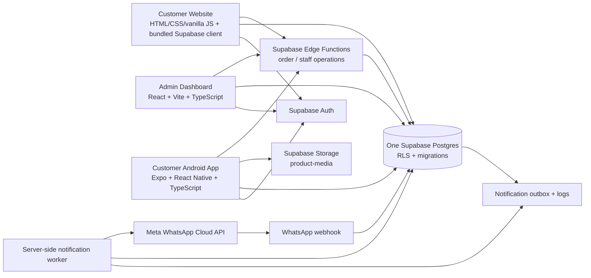

# Amar Bazar — System Architecture

**Phase:** 1 — Production Architecture & Infrastructure (design only)  
**Status:** Proposed; no application code, infrastructure, or live configuration was changed.  
**Reviewed:** six Phase 0 reports in `docs/audit/`.

## Architecture decision

Use the existing Supabase/Postgres implementation as the one shared backend for the customer website, staff dashboard, and Android app. Do not add a second API/backend. Keep the three presentation clients because they serve different devices and operations, and preserve the root website’s existing HTML/CSS/vanilla-JavaScript UI.

The root website currently writes orders to browser `localStorage` and has no Supabase integration. To become a live ordering website, keep its design and client-side rendering, add only a small reproducible build/bundle step for the Supabase JavaScript SDK, and replace demo checkout/order/admin-preview calls with the existing authenticated Supabase paths. Do not allow its local staff preview to handle actual customer PII or live orders.

## Logical architecture



## Integration map and data access

| Client | Current code path | Production integration |
|---|---|---|
| Root customer website | Static site; `app.js` stores `amarCart`/`amarOrders` in `localStorage`; no backend calls | Keep UI and current branding. Replace checkout, order history, approval and preview-only data with Supabase Auth + publishable client + `create-order` / `customer-order-decision` Edge Functions. Read public catalog/areas/settings under RLS. |
| Admin Dashboard | React/Vite; Supabase sign-in, `current_staff_roles`, RLS-backed reads, Realtime order insert; writes via `order-operations` Edge Function | Preserve current dashboard and role checks. Continue direct reads subject to RLS; route business writes through the existing user-authenticated operation function and checked database RPCs. |
| Android customer app | Expo Router; phone OTP, catalog/area/settings reads, saved addresses/orders, `create-order` and quote decision invocation | Preserve current client. Use only its `EXPO_PUBLIC_` URL/publishable key. All prices, stock, fees and authoritative statuses remain server/database-owned. |
| Supabase | Five existing migrations, RLS, schema, order RPCs, storage policies, five Edge Functions | Reuse one schema/function set in local, staging and production environments. Apply the same migration history to each. Never let app clients use service-role credentials. |
| WhatsApp | Existing server-side outbox worker and signed webhook | Keep message sending server-side; dry-run first; use consented recipients and approved templates. Do not call Meta directly from web/Android clients. |

### Shared contract

- **System of record:** Supabase Postgres. Catalog, price, inventory, delivery area/fee, order, quote, state history and COD facts are shared by all clients.
- **Public reads:** active catalog, shops, categories, delivery areas and explicitly public store settings through RLS and narrow queries.
- **Customer writes:** address/profile through owner-scoped RLS where permitted; order creation and quote decisions through existing Edge Functions/RPCs.
- **Staff writes:** authenticated operation request through `order-operations`, then role-checked SQL functions. Do not trust role information supplied by client UI.
- **Realtime:** dashboard listens for permitted order inserts/changes only; Realtime is a convenience signal, not the source of truth. Refresh rows from Postgres.
- **Media:** product assets in `product-media`; public read is appropriate only for intentionally public product images. Staff upload/update remains role-checked.
- **Types:** migrations define canonical database contract. Generate/check Supabase TypeScript types per environment as a build artifact. A shared contract package can be considered later; do not create another backend or duplicate business logic now.

## Authentication and authorization

### Customers

- Phone OTP via Supabase Auth (the Android app already has this flow; SMS provider, delivery and rate limits are not configured/verified).
- Use the authenticated `auth.uid()` as customer identity. Address and order policies must scope to that identity.
- OTP proves account access; it does **not** confirm an order. Order confirmation remains a distinct shop-verification and quote-approval state transition.
- The future web client should use the same phone OTP and session model or an explicitly approved equivalent; do not create anonymous live checkout as a bypass around RLS.

### Staff

- Keep the current dashboard email/password sign-in until the owner chooses a stronger provider. Require strong unique credentials; prefer MFA if the selected plan/configuration supports it.
- Store roles in backend-owned tables/functions, not user-editable profile metadata. Existing roles: `admin`, `order_operator`, `catalog_manager`.
- `admin` provisions/revokes staff; `order_operator` handles orders/quotes/delivery/COD; `catalog_manager` handles shops/catalog/inventory. Store settings/role management remain admin-only.
- The root website’s demo staff modal is not a staff identity system and must be removed from the production workflow or clearly retained only as a local mock.

## Order and notification path

```text
Customer selects area + products
 → authenticated request with item IDs/quantities and idempotency key
 → Edge Function validates input and authenticated user
 → transactional DB function reads trusted price/fee and validates item/stock
 → pending_verification order + status history + outbox entry
 → staff calls shop and records availability/substitution/verified price/fee
 → customer sees exact quote and approves, requests change, or rejects
 → server validates quote version; approval reserves stock and creates COD due
 → staff confirms/prepares → out_for_delivery → delivered; record COD
 → outbox worker sends eligible approved notification template and records outcome
```

The above is an implementation design found in source, not evidence of a running production service. See `docs/audit/BACKEND_READINESS.md`.

## Deployment surfaces

- **Customer website:** static public storefront on Cloudflare Pages (or equivalent commercial static host), on the root domain. Existing GitHub Pages site may remain as a non-transactional preview only; [GitHub Pages policy excludes sites primarily facilitating commercial transactions](https://docs.github.com/en/pages/getting-started-with-github-pages/github-pages-limits).
- **Admin:** separate Cloudflare Pages project on a distinct subdomain (for example `admin.<owned-domain>`). It remains a public static bundle; security comes from Supabase Auth/RLS/backend authorization, never from obscurity.
- **Android:** continue Expo/EAS Android builds and publish only after the staged customer workflow passes. App calls the same Supabase production project after release configuration is approved.
- **Backend:** Supabase project per environment; Edge Functions and SQL migrations versioned in this repository. Supabase-managed Auth, Storage, Realtime and Postgres remain one vendor/backend.

## Non-functional requirements

- HTTPS everywhere, narrow CORS origins, explicit CSP/security headers, no secret values in client bundles.
- RLS must be tested with customer A/customer B and every staff role in staging before accepting data.
- Idempotent order creation; quote-version concurrency guard; transactional inventory reservation, sale and release.
- Add basic uptime/worker-failure alerts and a documented restore/rollback process before public ordering.
- Store personal data minimally; use no real customer records in development or staging.

## Decisions awaiting implementation approval

1. Confirm the primary public customer experience is the existing website, Android app, or both.
2. Select production Supabase region based on supported-region availability and latency tests from Bangladesh.
3. Select root/admin domains and static host account owner.
4. Choose phone OTP delivery provider/budget and staff MFA policy.
5. Confirm whether WhatsApp notifications start in dry-run, admin-only, or customer opt-in mode.

This document is a design proposal. It does not authorize Phase 2, migration deployment, account creation, payment, domain purchase, or public release.
