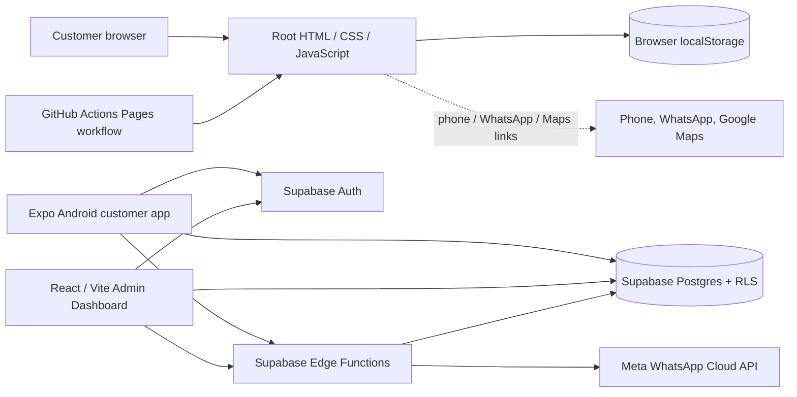

# Amar Bazar — Phase 0 Project Audit

**Audit date:** 2026-11-09  
**Scope:** Read-only source review and safe local static checks. This audit created documentation only. No application, database, deployment, or dependency files were changed.

## Executive summary

The repository contains three distinct application surfaces:

1. A deployed-style, static customer website at the repository root, implemented with HTML, CSS, and browser JavaScript. Its checkout and staff preview are local-only simulations using `localStorage`.
2. A separate Expo / React Native Android customer application in `apps/customer`. It has Supabase-backed catalog, authentication, customer-address, order, and quote-decision code paths, but requires environment configuration and a deployed compatible backend. The local configuration needed to prove this connection is absent.
3. A separate React / Vite TypeScript staff dashboard in `apps/admin`. It implements Supabase password sign-in, staff-role checks, live database reads, Realtime order inserts, and backend-mediated operations. Its production connection is likewise unverified.

Supabase migrations and Edge Functions are substantial and cover transactional order requests, staff shop verification, customer approval, order state transitions, inventory reservations, COD recording, and an outbox-based WhatsApp worker. Static source presence does **not** establish that migrations/functions are deployed or that any real Supabase project is operational. No live connection was tested.

## Current architecture



**Integration map:** The root website does not call Supabase. The Android client accesses Supabase tables for catalog and customer data and invokes Edge Functions for order creation/decision. The Admin Dashboard directly queries authorized Supabase tables and invokes `order-operations` for writes. The notification worker uses server-side service credentials and Meta credentials; the WhatsApp webhook verifies Meta signatures before recording delivery events.

## Technology and repository structure

| Area | Observed implementation | Evidence |
|---|---|---|
| Root customer website | Static HTML, CSS, vanilla JavaScript, local assets | `index.html`, `styles.css`, `app.js` |
| Android customer app | Expo SDK 58, React Native 0.88, TypeScript, Expo Router | `apps/customer/package.json`, `app.json` |
| Admin dashboard | React 19, Vite 7, TypeScript, Supabase JS | `apps/admin/package.json`, `src/App.tsx` |
| Backend | Supabase Postgres, RLS, SQL migrations, Edge Functions (Deno) | `supabase/migrations/`, `supabase/functions/` |
| Static deployment | GitHub Actions GitHub Pages deployment, triggered on `main` push/manual dispatch | `.github/workflows/deploy.yml` |

The root has no `package.json` or root build/test script. Admin and customer have package manifests and lockfiles. No test script is declared in either application manifest.

## Existing branding and reusable assets

- Amar Bazar branding is green, with dark forest green, bright/leaf green and orange accents; the customer application defines reusable colors in `apps/customer/constants/theme.ts`.
- Root site uses the SVG brand asset under `assets/`; the Android app includes a PNG icon, SVG mark, Codepotro font and product/delivery imagery under `apps/customer/assets/`.
- Root website includes category/product photos, cafe partner/menu imagery, support phone/WhatsApp links and an embedded map/location affordance.
- Catalog data, product imagery, menu transcription, sample area fees and the user-provided Half Time Cafe menu can seed a reviewed pilot catalog. Current demo numbers must be verified with participating shops before real sales.

## Customer features found

### Root website

- Product/category browsing, search, restaurant menu expansion, cart quantity controls and estimated area-based delivery fee.
- Checkout collects name, Bangladesh mobile, delivery area, address, optional landmark/note and optional geolocation.
- Creates a browser-local order, clears the browser-local cart, and shows a simulated progress/approval view.
- Includes a staff-preview modal in the same website. It can simulate shop checks, edit sample line prices/availability, ask the customer-preview UI for approval and mark an approved order as preparing.

These root features are a prototype only. There is no persistent server-side order or account, no authenticated staff boundary, and no cross-device sharing. The staff preview and customer preview share the same browser origin and `localStorage`.

### Android app

Screens/routes are present for onboarding, home, categories/search, product details, cart, sign-in, checkout, request receipt, orders/order detail, profile and address management. Cart persistence uses AsyncStorage. Catalog and settings load from Supabase; checkout calls `create-order` using a saved idempotency key; order details can retrieve status history and submit a quote decision.

The app has no mock-catalog fallback when Supabase is unconfigured: it shows an explicit backend-required state. Static sample product records exist in `apps/customer/data/mockData.ts`, but the catalog provider does not use them for live fallback.

## Existing Admin Dashboard capabilities

- Email/password sign-in through Supabase Auth; checks `current_staff_roles` and denies sessions with no active role.
- Role-based visibility for overview/orders, catalog, categories, notification management and store settings.
- Reads authorized order, item, product, inventory, category, shop, delivery-area, setting and notification records.
- Subscribes to Realtime order inserts when an authorized order operator/admin is signed in.
- Calls `order-operations` for shop/price quote verification, phone outcome, order status transitions, COD recording, catalog/stock/area/settings changes, staff-role assignment and notification retry.
- Provides a clearly labelled read-only `?preview=1` demo screen when backend configuration is missing.

The preview is not live operational data. No credentials or live account were used in this audit.

## Data, checkout, and business workflow

The root website writes `amarCart` and `amarOrders` into browser `localStorage`; order lines, customer PII, location, status and sample quote are therefore device/browser-specific and editable by that user. There is no server-side validation, reliable reference/idempotency, stock reservation, customer identity, admin authentication, shop verification call, customer quote messaging, COD record, or delivery completion.

The separate Supabase backend code is designed for the intended workflow:

```text
Customer submits request
  → server prices active products and delivery area, validates items, records idempotently
  → staff calls shop and records item availability / substituted item / final price / delivery fee
  → customer reviews quote and approves or requests changes
  → server reserves tracked inventory and creates pending COD record
  → staff moves order through confirmed → preparing → out_for_delivery → delivered
  → staff records COD collection
```

Core SQL and Edge Function code exists. This workflow has **not** been exercised against a running database, so every operational claim remains unverified.

## Security and technical risks

- Root localStorage is not a secure source of truth and cannot protect personal data or staff operations.
- Root staff controls have no authentication/authorization; never use them for real fulfillment.
- Supabase design uses a public/publishable client key with RLS, role checks and server-only service-role/Meta keys. Local `.env` files for the root/admin/customer/Edge Functions were not present at audit time; only `.env.example` files exist.
- The Admin UI also exposes a read-only demo route with fictional records; it is separate from the live secure route, but must remain clearly marked.
- The Pages workflow uploads repository root (`path: .`) without a build. If internal admin/backend source is later committed to this repository, review whether it should be included in the public Pages artifact; no secret was printed or found in the checked env templates.
- Admin auth is password-based in inspected code; MFA, account provisioning, recovery policy, server rate limiting, backups and production monitoring were not verified.
- Build/typecheck checks are not business-logic tests or security penetration tests.

## Local verification evidence

| Check | Result | Classification |
|---|---|---|
| `node --check app.js` | Passed | Static JavaScript syntax check |
| Admin TypeScript `tsc --noEmit --incremental false` | Passed | Static type check |
| Customer TypeScript `tsc --noEmit --incremental false` | Passed | Static type check |
| Admin Vite production build to a temporary directory | Passed; 74 modules transformed | Local build, not deployed |
| Local static-site HTTP request to `127.0.0.1:4173` | Blocked by the environment: socket access denied | No manual browser test |
| Supabase CLI | Not installed/available | Migrations/functions not run locally |
| Supabase connection / remote project status | UNVERIFIED; no local `.env` and no live credentials used | Not connected/tested |
| Customer Android export / APK build | Not run in this audit | Existing APK/Expo account not verified here |
| Checkout, admin actions, notification, RLS attack tests | Not run against a database | Must be tested in isolated staging |

`pnpm exec` was also attempted for the type checks but tried to create an external pnpm symlink and failed with EPERM; the already-installed local TypeScript binaries were then run directly and passed. No packages were installed.

## Phase 1 recommendation

Before rebuilding further, approve a focused implementation plan:

1. Decide which customer surface becomes the primary pilot: root web or Android. Avoid operating two independent checkout implementations.
2. Provision a non-production Supabase staging project and publishable client configuration only; keep service-role/Meta secrets in server-side project secrets.
3. Apply migrations in staging and verify seed records before any real customer traffic.
4. Test customer identity, area fee, catalog, price/stock validation, idempotent request creation and the complete shop-quote/customer-approval workflow with synthetic staging data.
5. Test staff roles and every order transition, COD collection, RLS cross-customer isolation, and outbox retries.
6. Restrict the GitHub Pages artifact to the intended static public-site output; define separate deployment workflows for admin and mobile if needed.
7. Capture screenshots and test on a physical Android device only after backend staging works.
8. Keep the root website's localStorage flow clearly in demo mode until it is replaced by an authenticated, server-backed request flow.

## Audit conclusion

The repository holds a credible **implementation blueprint and code** for the full pilot workflow, alongside a separate local-only web prototype. The Admin Dashboard and Supabase functionality are not proven live. At the repository level, Supabase backend implementation is substantial and appears intended to be production-shaped; at the deployed-service level, readiness is **UNVERIFIED**. No Phase 1 work was started. Await project-owner approval.
