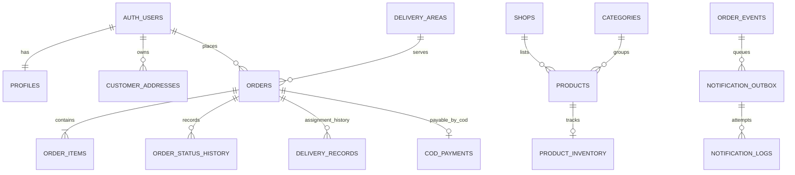

# Amar Bazar database schema

**Status:** Repository schema documented; live Supabase schema is unverified. This file describes version-controlled SQL, not a confirmed deployed database.

## Environments and source of truth

PostgreSQL in Supabase is the single system of record for the customer Android app, admin dashboard, and any future connected storefront. The root static website still uses browser Local Storage and is not connected to this schema. Apply the same ordered migrations to a disposable local stack and an isolated staging project before considering production. Never reset a linked/remote project.

## Tables and relationships

| Area | Tables | Purpose / key relationship |
|---|---|---|
| Identity | `profiles` | One row per `auth.users.id`; customer display name and phone. |
| Staff roles (private schema) | `app_private.admin_profiles`, `app_private.user_roles` | Backend-maintained staff status and role assignments. Roles: `admin`, `order_operator`, `catalog_manager`. |
| Shops and catalog | `shops`, `categories`, `products`, `product_price_history` | Product references one shop and category; SKU unique within shop when supplied; price changes are audited. |
| Inventory | `product_inventory`, `stock_movements` | One inventory row per tracked product; reserved quantity cannot exceed on-hand quantity; movement ledger references product and optionally order. |
| Delivery pricing | `delivery_areas`, `customer_addresses` | Orders/addresses reference an area; fee and area name are copied into order snapshots. Address belongs to one Auth user. |
| Store configuration | `store_settings` | Singleton row controls order/COD enablement, contact information, item limits and COD tolerance. |
| Order and verification | `orders`, `order_items`, `order_item_checks`, `order_contact_attempts`, `customer_order_decisions`, `order_events`, `order_status_history` | Order belongs to an Auth customer; line items retain requested name/unit/price snapshots and final verified values; events/history preserve workflow. Order idempotency is unique per customer. |
| Delivery | `delivery_records` (added in `20261109000600`) | Assignment history per order, with assigned person name/phone, assigning staff member, status and timestamps. Lifecycle status changes preserve prior assignments; a partial unique index permits one active assignment per order. Driver identity is stored as operational contact data because there is no rider app/staff identity flow yet. |
| COD | `cod_payments` | At most one COD record per order; due and collected amounts are recorded separately with collector and time. |
| Notifications | `customer_notification_preferences`, `notification_outbox`, `notification_logs`, `notification_webhook_events` | Opt-in and audit trail, idempotent queue per order event/channel, attempts and provider webhook deduplication. |

### Core relationship sketch

## Integrity and transaction rules

- Money uses `numeric(12,2)` and the configured currency is BDT. Prices/fees/totals must be nonnegative; client totals are ignored.
- Phone numbers use E.164 format. Coordinates are range-checked. Names, notes, item counts, and quantities have database bounds.
- Order-line requested name, unit and price are snapshots. Historical order lines are not re-priced when catalog prices change.
- `create_order` verifies current product/shop/category/area state, reads database prices and delivery fees, hashes the canonical request and uses `(customer_id,idempotency_key)` uniqueness inside one transaction.
- Staff quote verification is guarded by order row lock and quote version. Customer approval checks owner and current version, reserves tracked stock, transitions to confirmed and creates COD due transactionally.
- `transition_order` validates the state graph, locks the order and consumes or releases reservations in the same transaction as delivery/cancellation status changes.
- The new `assign_order_delivery` RPC locks the order, allows assignment only while confirmed/preparing, keeps assignment history, and requires an active assignment before `out_for_delivery`. The status trigger advances it to `in_transit` and then `delivered`/`cancelled` with the order transition.
- Notification outbox creation is part of database event recording; a messaging failure does not roll back the order.
- COD collection is permitted only for an out-for-delivery/delivered order and is checked against the recorded amount due and store tolerance.

## Indexes and constraints

Existing migrations add unique keys for shop/category slugs, shop SKU, customer/idempotency key, order public code, one order line per product, one COD row per order, and one notification outbox item per event/channel. Operational indexes cover active product listings, owner order/address history, order status/creation, stock movements, notification queue scheduling, and event/status timelines. The delivery extension adds `(order_id, assigned_at desc)` plus a partial unique active-assignment index.

## Migration inventory

See [MIGRATION_LOG.md](MIGRATION_LOG.md) for ordered migration purpose and execution state. Existing files create core schema/RLS, order workflow functions, admin catalog functions/storage, customer Realtime publication, and dashboard/WhatsApp helpers. The final migration is additive. None has been executed against a live project in this work.

## Live-state caveat

No local database service, Supabase CLI, Docker, or PostgreSQL client is available in the current environment, and no environment configuration is present. Connectivity, deployed migration parity, SQL execution and runtime behavior remain **UNVERIFIED**. Do not treat this document as proof of a live database.
